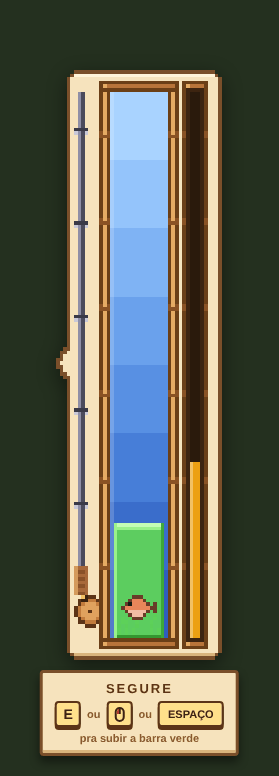

# lunar_fishing — Atitude RP

Sistema de pesca com zonas, níveis, NPC pescador e aluguel de barco. Quando o peixe morde, abre um **minigame no estilo Stardew Valley** no lugar do skill check do ox_lib.

<p align="center">
  
</p>

Baseado no lunar_fishing da Lunar Scripts (licença GPL-3, mantida em `LICENSE`).

---

## Como funciona o minigame

Quando o peixe morde a isca, aparece a vara com uma coluna de água. Dentro dela tem **o peixe**, que fica nadando pra cima e pra baixo, e **a barra verde**, que você controla. Do lado direito fica a **barra de progresso**.

| 1. O peixe mordeu | 2. Segure pra subir | 3. Pegou! | 4. Escapou |
|:---:|:---:|:---:|:---:|
|  |  |  |  |
| A barra verde começa lá embaixo e o progresso começa em 30%. Embaixo aparece a dica das teclas, piscando. | **Segure** clique esquerdo, `E` ou espaço: a barra verde **sobe**. **Solte**: ela **cai**. As teclas da dica ficam verdes enquanto você segura. | Com o peixe **dentro da barra verde**, o progresso enche e o molinete gira. Encheu tudo: o peixe vai pro inventário. | Com o peixe **fora da barra**, o progresso esvazia. Se zerar, o peixe foge e a vara pode quebrar. |

### Dicas

- A barra verde tem peso: se você segurar demais, ela embala e passa do peixe. Funciona melhor dar **toques curtos** pra ela ficar parada.
- Quando o peixe está dentro da barra, a gravidade diminui, então fica mais fácil segurar ele ali.
- Se pegar o peixe **sem ele sair da barra nenhuma vez**, aparece **PERFEITO!**.
- **Vara melhor = barra verde maior.** A vara básica tem a barra pequena, a de grafite é média e a de titânio é a maior.
- Cada peixe nada de um jeito. A anchova é fácil e dá uns trancos; a garoupa puxa pro fundo; o atum é rápido e suave; o tubarão é o mais difícil de todos.

Se o jogador morrer, cair (ragdoll) ou entrar na água durante o minigame, ele fecha e conta como falha.

---

## Como pescar

1. Compre uma vara e iscas com o NPC pescador. Varas, iscas e zonas melhores liberam conforme o nível de pesca (skill `fishing` do `cw-rep`).
2. Fique em pé de frente para a água (não funciona nadando nem dentro de veículo).
3. **Use a vara pelo inventário.** A isca mais cara que você tiver é gasta.
4. Espere a mordida. A isca artificial faz o peixe morder mais rápido. Enquanto espera, segurar `E` cancela.
5. Quando morder, jogue o minigame.
6. Venda os peixes no NPC pescador.

### Zonas e peixes

| Lugar | Nível | Peixes |
|---|:---:|---|
| Qualquer água (fora das zonas) | 0 | anchova, truta, hadoque, salmão |
| Recife de coral | 1 | mahi-mahi, vermelho + os de fora |
| Pântano | 2 | piranha + os de fora |
| Águas profundas | 3 | garoupa, atum, tubarão |

### Dificuldade de cada peixe

| Peixe | Dificuldade | Jeito de nadar |
|---|:---:|---|
| Anchova (`anchovy`) | 20 | dá trancos |
| Truta (`trout`) | 25 | misto |
| Hadoque (`haddock`) | 35 | puxa pro fundo |
| Salmão (`salmon`) | 45 | misto |
| Vermelho (`red_snapper`) | 50 | misto |
| Garoupa (`grouper`) | 55 | puxa pro fundo |
| Mahi-mahi (`mahi_mahi`) | 60 | suave |
| Piranha (`piranha`) | 65 | dá trancos |
| Atum (`tuna`) | 75 | suave |
| Tubarão (`shark`) | 85 | misto |

---

## Configuração do minigame

Tudo fica em `config/config.lua`.

**Cada peixe** tem um campo `minigame`:

```lua
['salmon'] = {
    price = { min = 200, max = 250 }, chance = 10,
    skillcheck = { 'easy', 'easy', 'medium' }, -- só usado se não tiver `minigame`
    minigame = { difficulty = 45, behavior = 'mixed', color = '#e8865a' }
},
```

- `difficulty`: de 1 a 100, igual ao Stardew Valley.
- `behavior`: `mixed` (de tudo um pouco), `dart` (dá trancos), `smooth` (suave), `sinker` (puxa pro fundo), `floater` (puxa pra cima).
- `color`: cor do peixinho no minigame.

**O minigame em geral** fica em `Config.minigame`:

```lua
Config.minigame = {
    barSize = { basic_rod = 96, graphite_rod = 120, titanium_rod = 150 }, -- tamanho da barra verde por vara (o trilho tem 568)
    defaultBarSize = 96,
    startProgress = 0.3, -- progresso inicial (0 a 1)
    gainRate = 0.002,    -- quanto enche por tick com o peixe dentro da barra
    lossRate = 0.003,    -- quanto esvazia por tick com o peixe fora
    scale = 3.6,         -- tamanho na tela
    position = { x = 62, y = 50 }, -- posição na tela em %
    sound = true,
    hint = true,         -- plaquinha com as teclas
}
```

Pra testar o visual sem entrar no jogo, abra `html/index.html?test` no navegador (segure o clique ou o espaço).

---

## Instalação

1. Copie a pasta `lunar_fishing` para `resources` e coloque `ensure lunar_fishing` no `server.cfg` (depois do `ox_lib`, `oxmysql` e `cw-rep`).
2. Copie as imagens de `install/images/` para a pasta de imagens do inventário (no ox_inventory: `ox_inventory/web/images`).
3. Cadastre os itens no inventário. Os modelos prontos estão em `install/OX.md`, `install/QBCore.md` e `install/ESX.md`.
4. Não precisa importar o `install/import.sql`: nesta versão o nível vem do `cw-rep`.

Dependências: `ox_lib`, `oxmysql`, `qb-core` (ou `es_extended`), `cw-rep`, `rep-talkNPC`, `qtarget`/`ox_target` e um inventário compatível. A documentação completa (todas as configs, callbacks e eventos) está em [MANUAL.md](MANUAL.md).

---

## O que mudou em relação ao original

- Minigame estilo Stardew Valley no lugar do `lib.skillCheck` (`html/` e `client/minigame.lua`), com dica das teclas na tela.
- `server/main.lua` manda o nome do peixe e da vara pro cliente (pra saber o tamanho da barra).
- Corrigido: o tempo de espera das zonas de pesca não era usado (sempre caía no de fora das zonas).
- Corrigido: erro de digitação em `setCanRagdoll` (`statefalse`).
