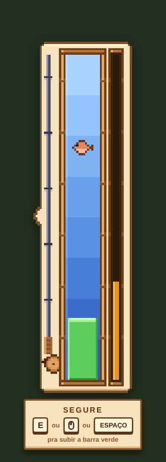
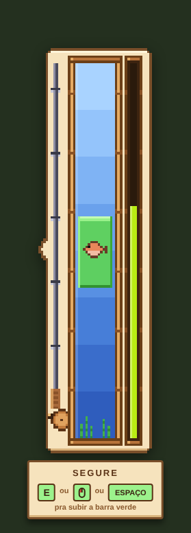
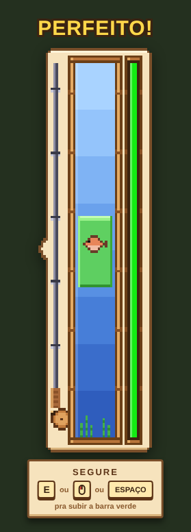
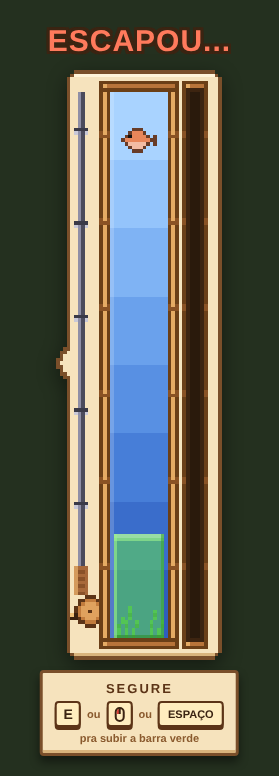
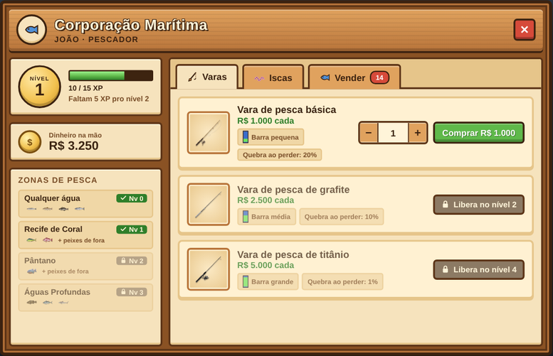
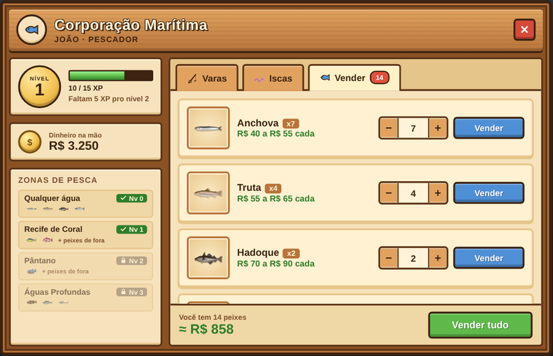

# lunar_fishing — Atitude RP

Sistema de pesca com zonas, níveis, NPC pescador e aluguel de barco. Quando o peixe morde, abre um **minigame no estilo Stardew Valley** no lugar do skill check do ox_lib, e o NPC pescador tem um **painel próprio** de compra e venda no mesmo visual.

<p align="center">
  
</p>

Baseado no lunar_fishing da Lunar Scripts (licença GPL-3, mantida em `LICENSE`).

---

## Como funciona o minigame

Quando o peixe morde a isca, aparece a vara com uma coluna de água. Dentro dela tem **o peixe**, que fica nadando pra cima e pra baixo, e **a barra verde**, que você controla. Do lado direito fica a **barra de progresso**.

| 1. O peixe mordeu | 2. Segure pra subir | 3. Pegou! | 4. Escapou |
|:---:|:---:|:---:|:---:|
|  |  |  |  |
| A barra verde começa lá embaixo e o progresso começa em 30%. Embaixo aparece a dica das teclas, piscando. | **Segure** clique esquerdo, `E` ou espaço: a barra verde **sobe**. **Solte**: ela **cai**. As teclas da dica ficam verdes enquanto você segura. | Com o peixe **dentro da barra verde**, o progresso enche e o molinete gira. Encheu tudo: o peixe vai pro inventário. | Com o peixe **fora da barra**, o progresso esvazia. Se zerar, o peixe foge e a vara pode quebrar. |

### Dicas

- A barra verde tem peso: se você segurar demais, ela embala e passa do peixe. Funciona melhor dar **toques curtos** pra ela ficar parada.
- Quando o peixe está dentro da barra, a gravidade diminui, então fica mais fácil segurar ele ali.
- Se pegar o peixe **sem ele sair da barra nenhuma vez**, aparece **PERFEITO!**.
- **Vara melhor = barra verde maior.** A vara básica tem a barra pequena, a de grafite é média e a de titânio é a maior.
- Cada peixe nada de um jeito. A anchova é fácil e dá uns trancos; a garoupa puxa pro fundo; o atum é rápido e suave; o tubarão é o mais difícil de todos.

Se o jogador morrer, cair (ragdoll) ou entrar na água durante o minigame, ele fecha e conta como falha.

---

## Painel do pescador

Falando com o João (NPC pescador), abre o painel da **Corporação Marítima** no lugar do menu do ox_lib.

| Comprar | Vender |
|:---:|:---:|
|  |  |

- **Lateral:** seu nível, a barra de XP com quanto falta pro próximo nível, o dinheiro na mão e as zonas de pesca (liberadas e bloqueadas, com os peixes de cada uma).
- **Varas:** mostra o tamanho da barra verde no minigame e a chance da vara quebrar quando o peixe escapa.
- **Iscas:** mostra se o peixe morde mais rápido.
- **Vender:** quantos peixes de cada tipo você tem e quanto cada um paga. O **Vender tudo** vende tudo de uma vez e mostra o total estimado. A aba ganha um contador com a quantidade de peixes.
- Itens que o seu nível ainda não libera aparecem com **"Libera no nível X"**.
- A quantidade se escolhe no próprio cartão. Compra e venda são na hora, com o aviso dentro do painel. Fecha com **ESC** ou no **X**.
- O servidor confere nível, dinheiro e quantidade em toda compra e venda.

Configuração em `Config.shop` (`config/config.lua`):

```lua
Config.shop = {
    enabled = true,          -- false = volta pro menu antigo do ox_lib
    title = 'Corporação Marítima',
    outsideLabel = 'Qualquer água', -- nome da "zona" de fora no painel
    maxAmount = 100,         -- quantidade máxima por compra
}
```

O nome de cada zona no painel vem do campo `label` em `Config.fishingZones`. Pra testar fora do jogo, abra `html/index.html?shop` no navegador.

---

## Níveis

O XP de pesca fica no `cw-rep` (skill `fishing`). Cada peixe pescado dá **1 XP** (`Config.progressPerCatch`), e o nível sai da mesma tabela do `cw-rep`:

| Nível | XP (= peixes pescados) | O que libera |
|:---:|:---:|---|
| 1 | 10 | Recife de Coral |
| 2 | 25 | Pântano, vara de grafite e isca artificial |
| 3 | 48 | Águas Profundas |
| 4 | 82 | Vara de titânio |

Dá mais ou menos 1 hora de pesca até o nível 4. Ao subir de nível, o jogador recebe um aviso e as novas zonas aparecem no mapa na hora.

> A tabela fica em `Config.levels` e **precisa ser igual** ao `Config.DefaultLevels` do `cw-rep` (`baseExp = 10`, `scaleFactor = 1.5`, `levelCount = 30`). Se mudar lá, mude aqui também.

---

## Como pescar

1. Compre uma vara e iscas no painel do NPC pescador. Varas, iscas e zonas melhores liberam conforme o nível de pesca (veja [Níveis](#níveis)).
2. Fique em pé de frente para a água (não funciona nadando nem dentro de veículo).
3. **Use a vara pelo inventário.** A isca mais cara que você tiver é gasta.
4. Espere a mordida. A isca artificial faz o peixe morder mais rápido. Enquanto espera, segurar `E` cancela.
5. Quando morder, jogue o minigame.
6. Venda os peixes no painel do NPC pescador.

### Zonas e peixes

| Lugar | Nível | Espera da mordida | Peixes |
|---|:---:|:---:|---|
| Qualquer água (fora das zonas) | 0 | 10 a 25 s | anchova, truta, hadoque, salmão |
| Recife de coral | 1 | 12 a 25 s | mahi-mahi, vermelho + os de fora |
| Pântano | 2 | 12 a 25 s | piranha + os de fora |
| Águas profundas | 3 | 25 a 45 s | garoupa, atum, tubarão |

A isca artificial (nível 2, R$ 60) corta a espera pela metade.

### Peixes: dificuldade e preço

| Peixe | Dificuldade | Jeito de nadar | Paga (R$) |
|---|:---:|---|:---:|
| Anchova (`anchovy`) | 20 | dá trancos | 40 a 55 |
| Truta (`trout`) | 25 | misto | 55 a 65 |
| Hadoque (`haddock`) | 35 | puxa pro fundo | 70 a 90 |
| Salmão (`salmon`) | 45 | misto | 110 a 140 |
| Vermelho (`red_snapper`) | 50 | misto | 210 a 250 |
| Mahi-mahi (`mahi_mahi`) | 60 | suave | 240 a 290 |
| Garoupa (`grouper`) | 55 | puxa pro fundo | 280 a 340 |
| Piranha (`piranha`) | 55 | dá trancos | 510 a 630 |
| Atum (`tuna`) | 75 | suave | 620 a 750 |
| Tubarão (`shark`) | 85 | misto | 1.400 a 1.700 |

### Quanto rende por hora

Os preços foram equilibrados simulando milhares de pescarias com um jogador médio (tempo de reação humano), já descontando isca, vara quebrada e aluguel do barco:

| Lugar | Vara básica | Vara de grafite | Vara de titânio |
|---|:---:|:---:|:---:|
| Fora das zonas (nível 0) | **~5 mil/h** | ~5,7 mil/h | ~6,5 mil/h |
| Recife (nível 1) | **~6,5 mil/h** | ~9,3 mil/h | ~11 mil/h |
| Pântano (nível 2) | ~5,3 mil/h | **~10 mil/h** | ~14,5 mil/h |
| Águas profundas (nível 3) | ~6 mil/h | **~12 mil/h** | ~23 mil/h |

Em negrito: a vara que o jogador normalmente tem quando libera a zona. A vara de titânio (nível 4, R$ 5.000) é o fim do jogo. Jogador ruim ganha menos (o peixe escapa mais e a vara quebra); jogador bom ganha mais.

---

## Configuração do minigame

Tudo fica em `config/config.lua`.

**Cada peixe** tem um campo `minigame`:

```lua
['salmon'] = {
    price = { min = 200, max = 250 }, chance = 10,
    skillcheck = { 'easy', 'easy', 'medium' }, -- só usado se não tiver `minigame`
    minigame = { difficulty = 45, behavior = 'mixed', color = '#e8865a' }
},
```

- `difficulty`: de 1 a 100, igual ao Stardew Valley.
- `behavior`: `mixed` (de tudo um pouco), `dart` (dá trancos), `smooth` (suave), `sinker` (puxa pro fundo), `floater` (puxa pra cima).
- `color`: cor do peixinho no minigame.

**O minigame em geral** fica em `Config.minigame`:

```lua
Config.minigame = {
    barSize = { basic_rod = 104, graphite_rod = 120, titanium_rod = 136 }, -- tamanho da barra verde por vara (o trilho tem 568)
    defaultBarSize = 104,
    startProgress = 0.3, -- progresso inicial (0 a 1)
    gainRate = 0.002,    -- quanto enche por tick com o peixe dentro da barra
    lossRate = 0.003,    -- quanto esvazia por tick com o peixe fora
    scale = 3.6,         -- tamanho na tela
    position = { x = 62, y = 50 }, -- posição na tela em %
    sound = true,
    hint = true,         -- plaquinha com as teclas
}
```

Pra testar o visual sem entrar no jogo, abra `html/index.html?test` no navegador (segure o clique ou o espaço).

---

## Instalação

1. Copie a pasta `lunar_fishing` para `resources` e coloque `ensure lunar_fishing` no `server.cfg` (depois do `ox_lib`, `oxmysql` e `cw-rep`).
2. Copie as imagens de `install/images/` para a pasta de imagens do inventário (no ox_inventory: `ox_inventory/web/images`).
3. Cadastre os itens no inventário. Os modelos prontos estão em `install/OX.md`, `install/QBCore.md` e `install/ESX.md`.
4. Não precisa importar o `install/import.sql`: nesta versão o nível vem do `cw-rep`.

Dependências: `ox_lib`, `oxmysql`, `qb-core` (ou `es_extended`), `cw-rep`, `rep-talkNPC`, `qtarget`/`ox_target` e um inventário compatível. A documentação completa (todas as configs, callbacks e eventos) está em [MANUAL.md](MANUAL.md).

---

## O que mudou em relação ao original

- Minigame estilo Stardew Valley no lugar do `lib.skillCheck` (`html/` e `client/minigame.lua`), com dica das teclas na tela.
- Painel do pescador no lugar do menu de contexto do ox_lib (`html/shop.*`, `client/shop.lua`, `server/shop.lua`).
- Preços, esperas das zonas e isca artificial equilibrados por simulação do minigame (veja [Quanto rende por hora](#quanto-rende-por-hora)).
- `server/main.lua` manda o nome do peixe e da vara pro cliente (pra saber o tamanho da barra).
- Corrigido: o tempo de espera das zonas de pesca não era usado (sempre caía no de fora das zonas).
- Corrigido: erro de digitação em `setCanRagdoll` (`statefalse`).
- Corrigido: o script comparava o **XP** do `cw-rep` com o nível exigido, então com 4 XP (um peixe) tudo ficava liberado, e o menu mostrava o XP que faltava errado. Agora o nível sai da tabela do `cw-rep` (`Config.getFishingLevel`), e o jogador é avisado quando sobe de nível.
- XP por peixe: 1 (era 5).
