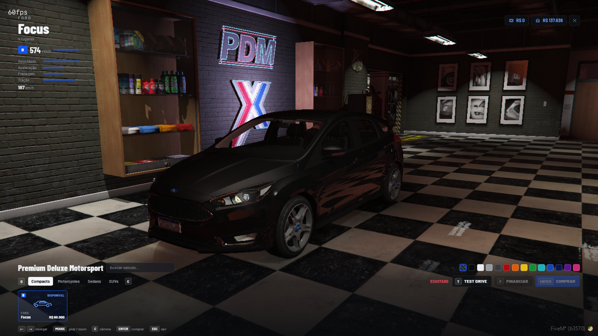

# qbx_vehicleshop — Painel de Concessionária

Versão modificada do [qbx_vehicleshop](https://github.com/Qbox-project/qbx_vehicleshop) (Qbox) para o **Atitude RP**.
Os carros expostos foram substituídos por um **painel de catálogo**: o jogador abre o painel, vê o veículo de verdade no salão, escolhe a cor e compra, financia ou faz o test drive.



## O que mudou em relação ao original

### Painel de catálogo (no lugar dos carros expostos)
- Abre pelo **mri_Qinteract** no ponto configurado de cada loja. Sem ele, usa o ox_target (`useTarget`) ou um marcador com **E**.
- O veículo selecionado aparece no salão, com câmera própria:
  - **mouse:** gira (arrastando) e dá zoom (roda)
  - **C:** troca o ângulo
- **Informações do veículo:** marca, nome, lugares, classe (D → S2), nota de 0 a 1000, barras de velocidade, aceleração, frenagem e tração, e velocidade máxima. Tudo é calculado do próprio modelo, **sem precisar de fotos**.
- **Navegação:**
  - categorias nas abas (**Q / E**)
  - lista de cards (**← / →**)
  - busca
  - dinheiro e banco do jogador
- **Cores:** 14 cores. A cor escolhida vai para o veículo comprado e fica salva na garagem.
- **Ações:**
  - **Test drive (T)**, **Financiar (F)** e **Comprar (Enter)**, com modal de confirmação
  - em lojas gerenciadas (`managed`), os botões viram **Vender / Financiar / Test drive** para um cliente, pelo ID
- **Clone do personagem:** um clone local do jogador aparece ao lado do veículo fazendo uma animação (celular, café...). Os props são limpos ao trocar de veículo.
- **Estoque:** mostra o estoque (via `mri_Qvehicles`) e bloqueia a compra quando esgota.

### Cronômetro do test drive
O texto 2D foi trocado por um widget no topo da tela: anel de progresso, tempo em `mm:ss`, nome do veículo e alerta vermelho nos últimos 30 s.


### Veículos vanilla escondidos da loja
- **`hideVanilla = true`:** esconde da loja todos os veículos do `qbx_core/shared/vehicles.lua` (os vanilla). Eles **continuam na base**: garagem, `/car`, preços.
- **`allowVanilla`:** lista de exceções, para vanilla que você quer continuar vendendo.
- **No servidor:** a compra de vanilla também é bloqueada, não só escondida no menu.

### Lojas sem NPC
Dentro da área de cada loja:
- os pontos de spawn de carros e pedestres do GTA ficam desligados
- carros e pedestres de NPC que entrarem são removidos

Carros de jogador, carros comprados, test drive e NPCs criados por script **não** são tocados.

### Outras correções
- O nome e a marca não quebram mais quando um modelo não está no catálogo. Antes, dava erro em `client/main.lua:143`.
- `SpawnVehicle` agora aplica as props completas do veículo (cor), não só a placa.

## Dependências
- [qbx_core](https://github.com/Qbox-project/qbx_core), [qbx_vehicles](https://github.com/Qbox-project/qbx_vehicles), [ox_lib](https://github.com/overextended/ox_lib), [oxmysql](https://github.com/overextended/oxmysql)
- Opcionais:
  - `mri_Qinteract`: interação para abrir o painel
  - `mri_Qvehicles`: estoque
  - `ox_target`: alternativa de interação

## Instalação
1. Coloque a pasta no lugar do `qbx_vehicleshop` original (o nome da pasta deve continuar `qbx_vehicleshop`).
2. Rode o `vehshop.sql` se ainda não tiver a tabela `vehicle_financing`.
3. Ajuste o `config/shared.lua`, conforme a seção abaixo.
4. `ensure qbx_vehicleshop`.

## Configuração (`config/shared.lua`)

### Ponto do painel e posição da prévia (por loja)
```lua
catalog = {
    coords = vec3(-54.9, -1096.45, 26.42),       -- onde o jogador abre o painel
    preview = vec4(-45.65, -1093.66, 25.44, 69.5), -- onde o veículo aparece
    -- ped = false,                               -- sem clone ao lado (ex.: barcos)
},
showroomVehicles = {}, -- carros expostos desativados
```

### Veículos vanilla
```lua
vehicles = {
    default = 'pdm',
    hideVanilla = true,
    allowVanilla = { --[[ 'sultan', ]] },
    ...
}
```

### Categorias que aparecem em cada loja
```lua
categories = {
    compacts = 'Compacts',
    sedans = 'Sedans',
    suvs = 'SUVs',
    motorcycles = 'Motorcycles',
},
```

Para mudar as cores e as animações do clone, edite `COLORS` e `PED_SCENARIOS` no início de `client/catalog.lua`. A cor principal do painel é a variável `--accent` em `html/style.css`.

## Licença
Este projeto é derivado do qbx_vehicleshop e segue a mesma licença: **GPL-3.0** (veja [LICENSE](LICENSE)).
Créditos ao [Qbox Project](https://github.com/Qbox-project) pelo script original.
